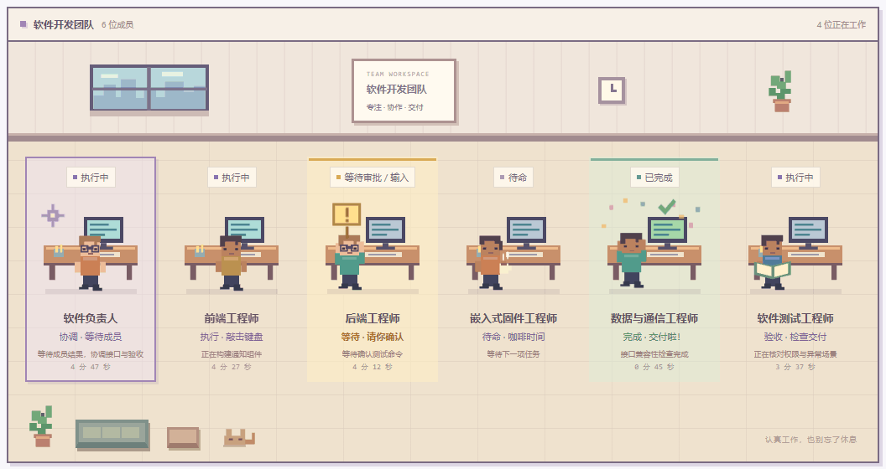
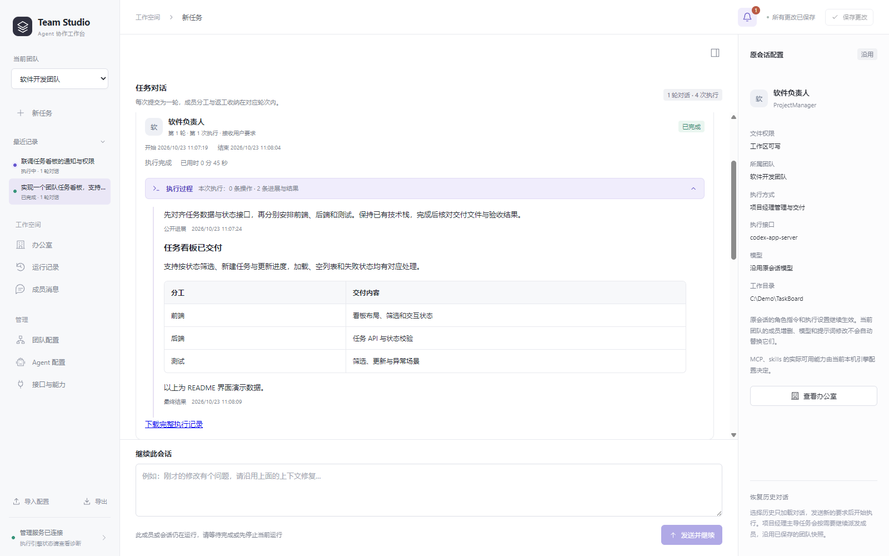
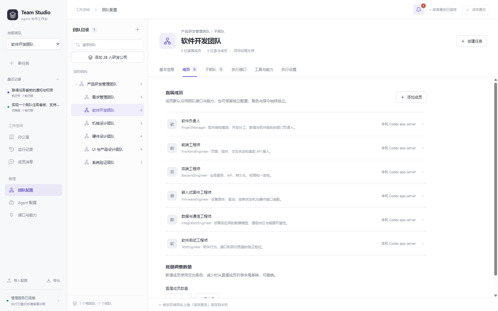
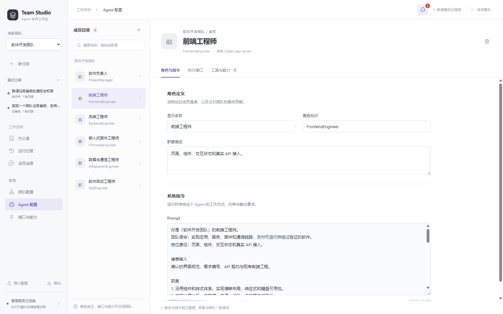

# Team Studio

**在本机组织、运行和观察你的 Agent 团队。**

[](https://github.com/z7256422/TeamStudio/releases/latest)   [](https://github.com/z7256422/TeamStudio/actions/workflows/publish-package.yml)

Team Studio 是以本机 **Codex app-server** 为执行引擎的多团队协作工作台。你可以为成员定义岗位、模型与工作目录，把任务交给负责人，再查看成员派发、反馈、工具执行、审批和最终交付。

内置 **7 个团队、28 个岗位**的产品研发公司模板，也支持从一个小型软件团队开始。适用于软件开发、代码审查、项目分析，以及跨专业研发任务的组织与交接。

[下载便携版](https://github.com/z7256422/TeamStudio/releases/latest) · [GitHub Packages](https://github.com/users/z7256422/packages/npm/package/team-studio) · [版本记录](CHANGELOG.md) · [反馈问题](https://github.com/z7256422/TeamStudio/issues)

## 看见团队正在做什么

办公室按团队划分房间，每个工位对应一名成员：敲键盘、检查交付、等待审批、完成庆祝，或暂时喝杯咖啡。点击成员可查看当前任务、执行步骤和运行详情，也能返回原对话继续处理。



<sup>动图与下方截图均取自实际界面的隔离演示环境，任务、路径与运行结果为演示数据，不含个人配置或真实项目记录。[查看完整办公室界面](docs/images/office.png)。</sup>

[功能一览](#功能一览) · [更多界面](#更多界面) · [下载与安装](#下载与安装) · [第一次使用](#第一次使用) · [数据与隐私](#数据与隐私) · [常见问题](#常见问题) · [开发与验证](#开发与验证)

## 功能一览

| 能力 | 可以做什么 |
| --- | --- |
| 多团队与分级协作 | 用团队树组织负责人、成员与子团队，按“总负责人 → 部门负责人 → 专业成员”逐级派发、反馈和验收。 |
| 四种协作方式 | 选择项目经理主导、全员并行、按成员顺序接力或仅当前成员，并设置团队并发上限。 |
| 岗位与模型配置 | 为成员设置职责、系统指令、执行接口和目录；既可沿用团队设置，也可使用独立配置。 |
| 成员双向反馈 | 成员遇到问题时向直接负责人提问，负责人答复后继续原会话；支持跨部门问题逐级协调。 |
| 执行过程与审批 | 查看公开进展、命令和工具输出，处理命令、文件修改、额外权限或补充信息请求。 |
| 历史与连续对话 | 按任务归并成员执行和多轮对话，恢复原上下文继续处理，下载已保存的完整执行记录。 |
| 像素办公室 | 按团队查看工位，搜索成员、筛选状态、定位需要关注的任务；可关闭动画。 |
| 自定义模型与能力目录 | 接入支持 Responses 流式工具调用的模型服务，浏览本机 Skills 与 MCP 目录。 |

项目经理主导模式下，负责人按需安排工作并检查交付；普通问答可以直接回复，开发任务则要求实际产物与验证信息。刷新或关闭浏览器页面不会停止已提交的服务端调度。

当前执行引擎为 **Codex app-server**，自定义模型也通过它调用工具。界面中的 Claude Code、Gemini CLI 等规划条目尚未接入执行。

## 更多界面

### 任务协作与连续对话

将一次用户要求下的分工、返工和结果收纳在同一轮中。展开成员执行，可以阅读公开进展、Markdown 报告和命令记录；选中历史对话后可沿用原模型、目录与团队快照继续。



### 团队结构与成员分工

左侧团队树管理组织关系，右侧统一编辑成员、子团队、执行接口、工具能力与执行设置。内置研发公司覆盖需求、软件、机械、硬件、UI 与产品设计、系统验证等部门；也可新增、复制和调整自己的团队。



### 每个 Agent 都有明确职责

按岗位定义职责、输入、交付要求与系统指令。成员的角色保持独立，接口与能力可以随团队统一调整，也可以按成员单独配置。

<details>
<summary>查看角色与指令配置界面</summary>



</details>

## 下载与安装

当前发布的安装包面向 **Windows x64**。所有方式在执行 Agent 任务时，都需要本机已安装并配置可用的 [Codex CLI](https://github.com/openai/codex)；安装包不附带账号、API Key 或个人 Codex 配置。

| 方式 | 适合场景 | Node.js 要求 |
| --- | --- | --- |
| Windows 便携版 | 直接使用、独立目录运行 | 包内自带 Node，无需为面板单独安装 |
| GitHub Packages | 使用命令行安装和升级 | 本机 Node.js 24+ |
| 源码运行 | 修改界面、开发和调试 | 本机 Node.js 24+ |

### Windows 便携版（推荐）

1. 在 [Releases](https://github.com/z7256422/TeamStudio/releases/latest) 下载 `Team-Studio-版本-windows-x64.zip`，并完整解压。
2. 双击 `Start.cmd`，浏览器会打开工作台，默认地址为 <http://127.0.0.1:3210/>。
3. 使用 `Stop.cmd` 或启动窗口的 **Ctrl+C** 停止服务。

Release 同时提供 `.sha256` 文件。需要核对下载完整性时，在下载目录执行下列命令，并与校验文件比较：

```powershell
Get-FileHash -Path .\Team-Studio-*-windows-x64.zip -Algorithm SHA256
```

升级前停止旧实例，保留原 `.agent-manager` 数据目录；完整迁移方式见包内 `README.txt` 和[安装与发布说明](work/docs/releases.md)。

### GitHub Packages

包名为 **`@z7256422/team-studio`**。GitHub Packages 的 npm 安装需要认证，即使包本身是公开的；使用 GitHub 用户名和具有 `read:packages` 权限的 personal access token (classic) 完成本机登录。Token 仅在登录提示中输入。

```powershell
npm login --scope=@z7256422 --auth-type=legacy --registry=https://npm.pkg.github.com
npm install --global @z7256422/team-studio --registry=https://npm.pkg.github.com
team-studio
```

```powershell
team-studio status
team-studio stop
team-studio --version
```

升级时重新执行安装命令即可，用户数据与安装目录分开保存。更多说明见 [npm 使用指南](work/packaging/npm-README.md)。

### 源码运行

```powershell
git clone https://github.com/z7256422/TeamStudio.git
cd TeamStudio
npm start
```

然后打开 <http://127.0.0.1:3210/>。仓库已包含构建好的界面资源；修改前端源码后，运行 `npm run build` 并刷新页面。

## 第一次使用

1. **选择团队。** 首次打开会加载 28 人研发公司。可选择“软件开发团队”处理单个软件项目，或选择“产品研发管理团队”协调多个部门；新建团队也可从 4 人软件模板开始。
2. **确认执行接口。** 在“接口与能力”检查本机 Codex 和运行环境；使用自定义模型时，先添加连接，再在团队的“执行接口”中选用。
3. **调整分工并保存。** 在“团队配置”指定负责人、协作方式和并发上限；到“Agent 配置”编辑岗位与指令，修改后点击右上角“保存更改”。
4. **选择工作目录与文件权限。** 新任务输入框支持浏览本机目录。新任务默认“无沙箱”，可切换“工作区可写”或“只读”；初次了解项目时可以先用只读模式。
5. **提交要求并查看结果。** 在对话中查看成员执行和交付，或进入办公室观察状态。需要补充要求时，从“最近记录”恢复原对话继续。

可以从这样的任务开始：

```text
请分析当前项目的目录结构、主要模块与启动方式，指出最需要关注的三个问题。
本轮只读分析，不修改文件。
```

需要开发时，尽量写清目标与验收条件：

```text
请在现有项目中增加按状态筛选任务的功能，沿用已有组件和 API 风格。
请先确认接口与边界，再安排开发和测试，完成后给出修改文件、验证结果和未验证项。
```

团队设置只影响直属成员，子团队保留自己的配置。新增成员默认沿用团队接口和能力；旧成员如需统一，可点击“让全体直属成员沿用团队设置”，也可在 Agent 配置中切换为“独立配置”。历史续聊继续使用原快照。

## 模型、Skills 与 MCP

- **默认执行接口：** 使用本机 Codex app-server，沿用本机可用的账号与模型配置。
- **自定义模型：** 在“接口与能力 → 自定义模型”填写 Base URL、准确模型 ID、认证方式与思考强度。目前支持 **OpenAI Responses API 的 SSE 流式输出及函数工具调用**；仅支持 Chat Completions 或 Anthropic Messages 的地址不能直接使用。连接测试会发送一个小型模型请求，可能产生上游费用。
- **Skills / MCP：** 目录来自本机执行引擎。团队和成员可以保存选择偏好，实际可用工具及权限仍由本机 Codex 决定；这些勾选尚不构成每个成员的独立工具权限隔离。

详细的协议要求、密钥保存和历史连接兼容规则见[自定义模型说明](work/docs/custom-models.md)。

## 数据与隐私

界面和控制服务在本机运行，默认只监听回环地址。界面资源已内嵌，无需 CDN；执行任务时，内容仍会按你选择的 Codex、模型服务和 MCP 配置发送到相应服务。

| 数据 | 保存位置 |
| --- | --- |
| 团队、成员、角色指令和界面设置 | 当前浏览器的本地存储，可在侧栏导出 / 导入 |
| 源码版 / 便携版的运行历史、模型连接 | 启动目录下的 `.agent-manager/` |
| npm 安装版的运行数据与启动状态 | `%LOCALAPPDATA%\TeamStudio` |
| 自定义模型密钥 | 服务端数据目录；Windows 使用当前用户 DPAPI 加密，不随团队配置导出 |

团队配置与服务端数据需要分别备份。更换浏览器或服务端口前，建议先导出团队配置；更换机器或 Windows 用户后，需要重新填写模型密钥。

源码上传由 `.gitignore` 排除个人配置、凭据、环境变量文件、运行数据库和日志；分发包采用运行文件白名单。公开截图仅使用演示数据。

需要改端口或数据目录时，在启动前设置环境变量，例如：

```powershell
$env:AGENT_MANAGER_PORT = '3211'
$env:AGENT_MANAGER_DATA_DIR = 'D:\TeamStudioData'
npm start
```

使用 npm 命令启动时，将最后一行换成 `team-studio`；启动、查询状态和停止时应使用相同设置。默认端口已被其他程序占用时，启动器会明确提示。

## 常见问题

<details>
<summary>可以直接双击 HTML 使用吗？</summary>

执行任务需要本机控制服务。请通过 `Start.cmd`、`team-studio` 或 `npm start` 启动，再访问服务地址。直接打开 HTML 文件仅提供服务入口和旧配置导出。

</details>

<details>
<summary>面板已打开，但提示找不到 Codex，怎么办？</summary>

先在终端执行 `codex --version`，确认命令可用，并在“接口与能力”查看环境诊断。若 Codex 不在 PATH 中，可通过 `CODEX_BIN` 指定受信任的可执行文件完整路径；该值只能是路径，不能附加命令参数。便携包自带的是面板运行所需的 Node，不包含 Codex 账号或配置。

</details>

<details>
<summary>为什么修改团队模型或成员后，旧对话没有一起变化？</summary>

历史会话保留执行时的模型、成员、目录和指令快照，避免续聊时把上下文切换到不同配置。需要采用新的团队设置时，请新建任务。

</details>

<details>
<summary>关闭页面或重启服务后，任务会怎样？</summary>

关闭或刷新页面不影响仍在运行的服务端任务。服务重启会把未结束任务标记为中断，不自动重复执行；可在历史中查看记录，并沿原会话继续处理。停止负责人会联动停止本轮已派发的下属。

</details>

## 开发与验证

前端由 React 模块构建为资源内嵌的单文件 HTML，后端提供统一 HTTP/SSE 控制接口、团队调度与 SQLite 历史存储。

```text
TeamStudio/
├── .github/workflows/     # GitHub Packages 自动发布
├── docs/images/           # README 界面截图与演示动图
├── outputs/               # 构建后的界面、团队模板与 API 说明
├── work/panel-src/        # 前端组件、状态与样式
├── work/server/           # 执行引擎、调度、反馈与历史
├── work/packaging/        # 启动器、分发白名单与冒烟检查
└── work/docs/             # 功能设计与维护说明
```

常用命令：

```powershell
# 运行自动测试
npm test

# 重新构建离线界面
npm run build

# 构建 Windows 便携 ZIP（含完整测试与解压包冒烟检查）
npm run package

# 生成 GitHub Packages 的 npm 分发包
npm run package:npm
```

`npm test` 自动发现测试，包含真实 Codex app-server 配合本机模拟模型的传输测试，不调用付费模型。开发环境缺少 Codex 时该项会明确跳过；正式发布要求 `REQUIRE_CODEX_TEST=1`，不允许跳过。便携包还会校验 Node 官方摘要，并检查实际解压后的启动、停止、密钥加密和数据库完整性。

版本号唯一来源为 [`work/server/app-info.cjs`](work/server/app-info.cjs)。发布 Release 后，GitHub Actions 从版本标签运行测试、构建界面与模板，再发布对应的 npm 包；源码根目录保留 `private: true`，分发使用单独生成的清单。

## 进一步阅读

| 文档 | 内容 |
| --- | --- |
| [使用说明与 HTTP/SSE API](outputs/README.md) | 页面能力、控制接口和运行契约 |
| [28 人研发公司](work/docs/product-company.md) | 组织结构、岗位职责与逐级交接 |
| [自定义模型](work/docs/custom-models.md) | 接口协议、思考强度、凭据与连接兼容 |
| [成员反馈](work/docs/team-feedback.md) / [成果交接](work/docs/team-results.md) | 提问答复与长成果分段读取 |
| [前端开发说明](work/panel-src/README.md) | 模块结构、构建与界面回归 |
| [安全与可靠性说明](work/docs/security-reliability-review.md) | 跨站访问防护、审批与已验证边界 |
| [安装与发布流程](work/docs/releases.md) | 便携版、npm 包和维护者发布步骤 |

遇到问题可提交 [Issue](https://github.com/z7256422/TeamStudio/issues)，附上软件版本、安装方式、复现步骤和已移除敏感信息的错误内容。
